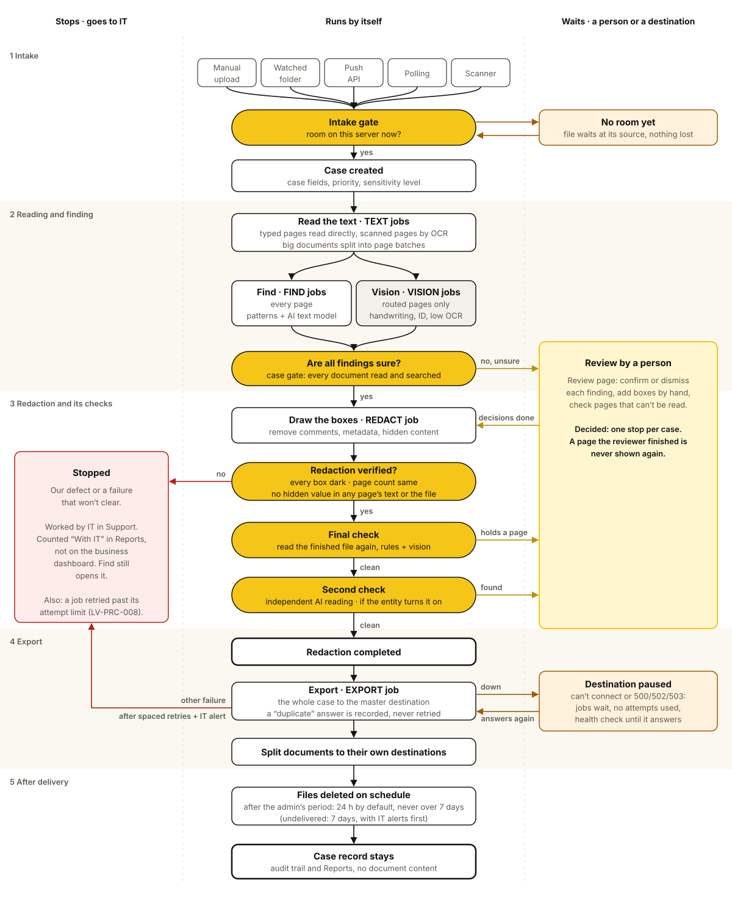
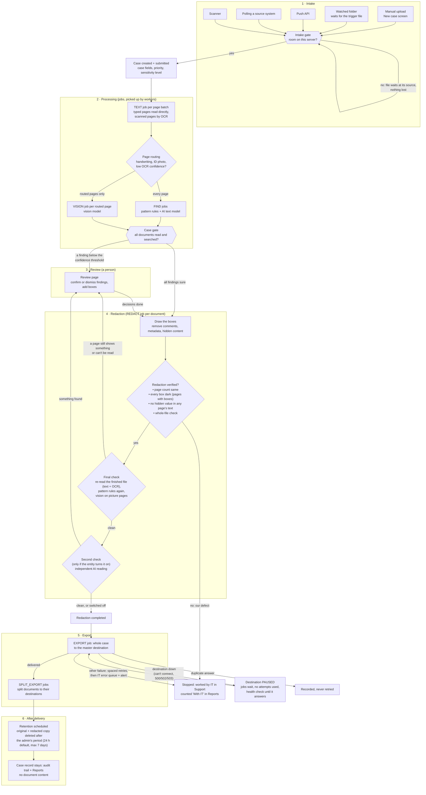
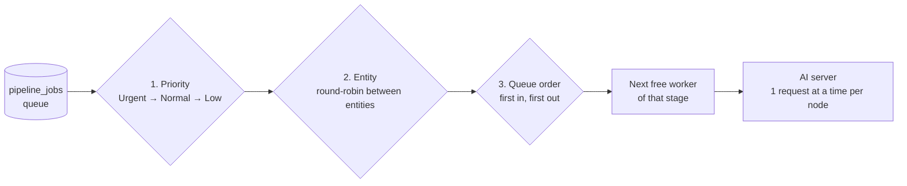

# LexaVault case processing flow

Drawn from the code on `feature/lexavault-r1b-tenant-identity` (head `ab07b75e`, 2026-11-27). It shows what the code
does today. Changes the owner has decided but that are not built yet are listed at the end.

Main classes: `IntakeGate`, `WatchedFolderIntakeService`, `StagedProcessingService` (TEXT / FIND / VISION / REDACT jobs
and the case gate), `DocumentRedactionService` (draw, verify, final check, second check), `ExportJobService`,
`DerivedRoutingService` (splits), `ExportRetentionService` / `EmptyCaseExpiryService`.

## The flow at a glance

Middle lane: what runs by itself. Right: where a case waits for a person or a destination. Left: where it stops and goes to IT.
The Mermaid diagrams below show the same flow with the job and class names.

## 1. The whole case (Mermaid)

## 2. How the workers share the work

- Workers per stage (TEXT, FIND, VISION, REDACT, EXPORT) are measured when the app starts, or set in `application.yml`.
- A large document is split into page batches, so it becomes many TEXT and FIND jobs.
- BULK cases run only while their source's window is open.
- A job whose server stops goes back to the queue. After the attempt limit the case stops with LV-PRC-008.

## 3. Decided, not built yet

| # | Change | Decided |
|---|---|---|
| 1 | **One review stop per case.** The final check runs before the first review, and a page shown to the reviewer counts as checked by a person and is never shown again. | Owner, 2026-11-27 23:21 |
| 2 | No OCR or vision on pages a person already checked. Keep the whole-file value search. | Design chat, 2026-11-27 |
| 3 | AI outage (0116): wait and resume by itself, one IT alert (15 min / 1 h / 1 day). | 2026-11-27 |
| 4 | Undelivered case: deleted after 7 days, IT alert at 1 day plus a final warning (0115). | 2026-11-27 |
| 5 | Round-robin between cases inside one entity as well (proposal, waiting for the owner). | Open |
