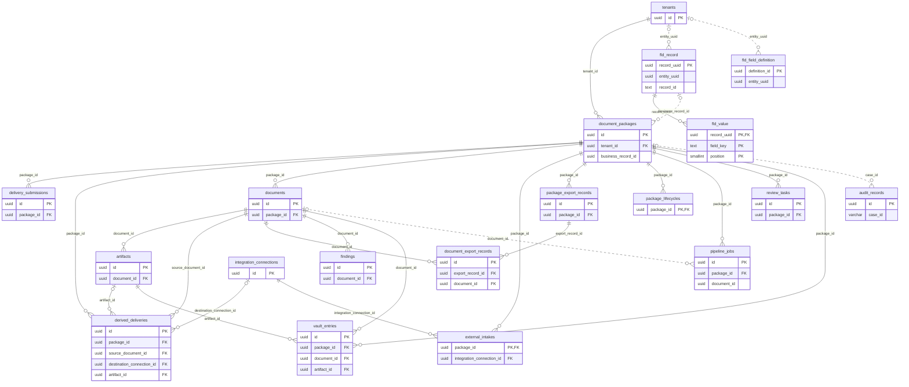

# LexaVault: how the main tables link

Generated with [DATA-DICTIONARY.md](DATA-DICTIONARY.md) by `scripts/Update-LexaVault-DataDictionary.ps1 (or .sh)`. Do not edit by hand.

Solid lines are foreign keys. Dotted lines are links the code joins on without a foreign key (listed under the diagram). Each box shows its primary key and the columns that link it. Nearly every table also has `tenant_id` → `tenants`: only the case's is drawn, and every query must filter on it.

## Links without a foreign key

| From | To | How the code matches them |
|---|---|---|
| `document_packages.business_record_id` | `fld_record.record_id` | record_id = business_record_id as text, record_type business-record |
| `fld_record.entity_uuid` | `tenants.id` | entity_uuid = tenants.id |
| `fld_field_definition.entity_uuid` | `tenants.id` | entity_uuid = tenants.id |
| `audit_records.case_id` | `document_packages.id` | coalesce(case_id, resource_id) = package id as text |
| `pipeline_jobs.document_id` | `documents.id` | document_id = documents.id |

Every other table and link is in [DATA-DICTIONARY.md](DATA-DICTIONARY.md) (its foreign keys and "Referenced by" lines).
