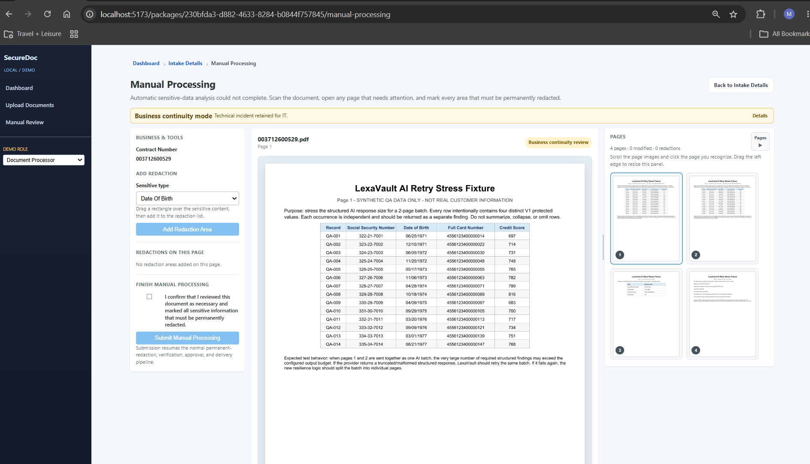

# LexaVault Business User Training Guide

**Audience:** Document Processor / Standard User, Elevated User, Business Admin  
**Current status:** R11 + AI Resilience + Business Continuity are VERIFIED / FROZEN.

---

## 1. What LexaVault does for Business

LexaVault processes documents to identify and permanently redact configured sensitive information before delivery.

For the current V1 baseline, protected categories are:

- Date of Birth
- Social Security Number
- Full payment-card number / PAN
- Credit Score

Business identifiers such as Contract Number, Member Number, Loan Number, Case Number, or Service Entity are not automatically treated as sensitive merely because they are numbers. Tenant configuration determines which business identifier is primary and how it is displayed.

---

## 2. Normal processing

Typical flow:

`Upload / Intake -> Automatic Analysis -> Redaction -> Approval (when required) -> Delivery`

If LexaVault is confident and policy allows it, no business review is required.

---

## 3. Normal Needs Review

Normal Needs Review is **system-guided**.

LexaVault has completed analysis but needs a business decision for one or more findings. The workbench focuses on the uncertain findings/pages rather than forcing review of the entire document.

The user may:
- open the finding/page requiring attention
- inspect the highlighted area
- confirm a true sensitive finding
- dismiss a false finding
- add a manual redaction if needed
- complete the normal review workflow

### Important
Normal Needs Review is not the same as Business Continuity Manual Processing.

- **Needs Review:** LexaVault completed analysis and knows what needs a decision.
- **Business Continuity:** automatic analysis could not safely complete, so the business user takes control of the document.

---

## 4. Business Continuity — Continue Manually

### When it appears

If automatic analysis fails even after safe bounded recovery, the document may enter Technical Attention.

If the PDF itself can still be safely rendered, manually redacted, verified, and delivered, a **Document Processor / Standard User** can select **Continue Manually**.

Business does **not** have to wait for Tenant IT or Platform Support to investigate the automation failure.

### What this means

- The underlying technical issue remains recorded for IT.
- You are taking responsibility for identifying the sensitive areas that require redaction.
- The workflow does not bypass permanent redaction or verification.
- There is no "force export original" option.

### Manual Processing screen

The screen has three primary areas:

**Business & Tools**
- Primary Business Identifier (for example Contract Number)
- Sensitive type selector
- Add Redaction Area
- Redactions on the selected page
- Finish Manual Processing / attestation

**Large document viewer**
- Displays the selected page at a usable size
- Used for precise redaction placement

**Pages**
- Shows actual miniature page-content thumbnails
- Scroll freely through the document
- Click any page visually; page numbers are only references
- Pages with redactions show a redaction count/status
- Panel may be resized or collapsed to increase document-viewing space

### You do not need to know page numbers

The thumbnail strip exists so you can visually recognize the page you need:
- credit report
- borrower information
- identity page
- table/form you recognize

You may jump directly to any page. You are not required to click Next through every page sequentially.

---

## 5. Adding a manual redaction

1. Select the page using its thumbnail.
2. Choose the sensitive type.
3. Select **Add Redaction Area**.
4. Draw the rectangle over the sensitive content.
5. Confirm that the new redaction appears in **Redactions on this page**.
6. Confirm the thumbnail shows the updated redaction count.

Use the smallest rectangle that completely covers the sensitive content.

---

## 6. Removing or correcting a redaction

Before final submission, use the current-page redaction list to remove an incorrect area, then add the corrected region.

The system retains audit history of the decision even when a manual region is removed.

---

## 7. Finishing Manual Processing

When you have reviewed the document as necessary and marked all sensitive information that must be permanently redacted:

1. Review the pages/redaction counts.
2. Check the confirmation:
   **"I confirm that I reviewed this document as necessary and marked all sensitive information that must be permanently redacted."**
3. Select **Submit Manual Processing**.

LexaVault then resumes the normal:
- permanent redaction
- verification
- approval (when configured)
- delivery

pipeline.

---

## 8. Business completion does not close the IT issue

A manually completed document can be:

- **Business:** Completed
- **Technical incident:** Still open / Business Continued

This is expected.

Business completion means the customer workflow was completed safely. It does not mean the automation defect was technically fixed.

---

## 9. What Business users must not do

Do not:
- export or distribute the unredacted original outside approved workflow
- assume "Technical Attention" means the business must stop
- copy sensitive document values into help-desk tickets
- paste SSNs, full PANs, DOBs, credit scores, OCR text, or screenshots containing protected data into support chat/tickets unless an approved secure support procedure explicitly requires it

When asking for help, provide:
- Contract Number / primary business identifier
- Incident ID if visible
- approximate time
- what workflow action you were performing

---

## 10. Role summary

### Document Processor / Standard User
May:
- use normal Manual Review
- continue a safe technical failure through Manual Processing
- add/remove manual redactions
- submit/approve as allowed by the business workflow

### Elevated User
Includes Standard User capabilities plus elevated lifecycle operations such as reprocessing/removal/deletion where authorized.

### Business Admin
Includes the business workflow plus administrative/reporting functions.

A Standard User does **not** need to wait for an Elevated User or Business Admin merely to use the Business Continuity manual-redaction workflow.
