# LexaVault guide for business users

**For:** Document Processor, Document Supervisor, Business Administrator ("Business Admin"), Report Viewer.
**Checked:** 2026-11-25 against the screens of commit `466906b1` (task 0095). Names in **bold** are the words on the screen.

The pictures hold made-up data only, and nothing that LexaVault would redact.

## 1. What LexaVault does

LexaVault takes in PDF documents, finds sensitive information, blacks it out for good, checks the result and sends the redacted copy to its destination. It is not a document store: nobody can download a document from it, and copies are deleted on time.

## 2. Who may do what

A person can have more than one role; then the rights add up. Your roles are listed in the account menu (your name, top right).

| | Processor | Supervisor | Business Admin | Report Viewer |
|---|:---:|:---:|:---:|:---:|
| **Cases**, **New case**, **Review** | yes | yes | no | no |
| **Continue manually** on a stopped case | yes | yes | no | no |
| **Reject case** while it is in Review | yes | yes | no | no |
| **Reject case** while it waits in Approval | no | yes | no | no |
| Change a case's **Priority** | yes | yes | no | no |
| **Approve** delivery, one case or several | no | yes | no | no |
| **Process again** an exported case | no | yes | no | no |
| Send a refused case again (**Waiting for you**) | yes | yes | no | no |
| See sensitive case field values (on the case itself) | yes | yes | no | no |
| **Reports** › Overview, Daily intake and delivery | no | no | yes | yes |
| **Reports** › Operations | no | no | yes | no (the tab says more detail is for Business Administrators) |
| **Export CSV**, **Compliance report** (summary) | no | no | yes | no |
| **Admin** › Redaction & retention, Case fields, Entities, Licensing, business Notifications | no | no | yes | no |
| **Help: error codes** | yes | yes | yes | yes |

Nobody on this list can: change connections or sign-in, retry processing, see the audit trail, or use Support. That is the IT Administrator (`../tenant-it/TENANT_IT_SUPPORT_GUIDE.md`). A Business Admin can't open a case; a number on Reports is then a plain number, not a link.

## 3. Entities and the switcher

Each entity keeps its own cases, rules and people. The entity you are in is always shown at the top, left of your name.

- **One entity:** you go straight in. **More than one:** you land in the one you used last, else on **Choose an entity**.
- **To switch:** open the entity's name at the top and choose another. Unsaved work asks first (**Stay** or **Switch anyway**).
- A suspended entity lets nobody in until it is resumed.

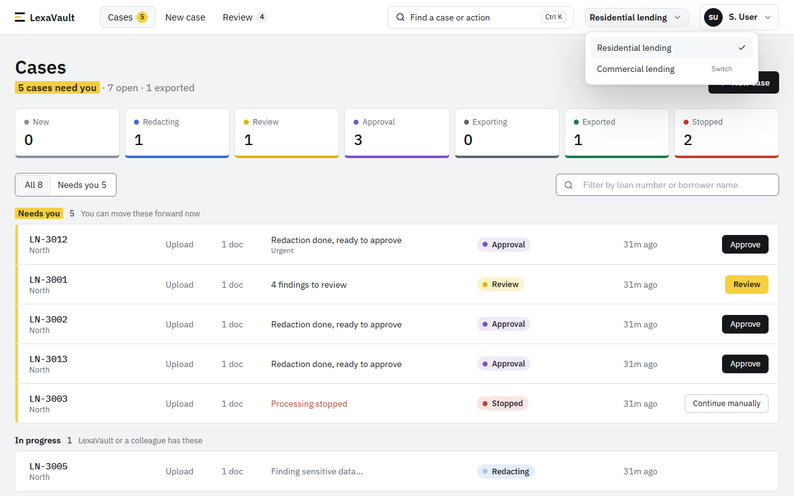

## 4. Cases

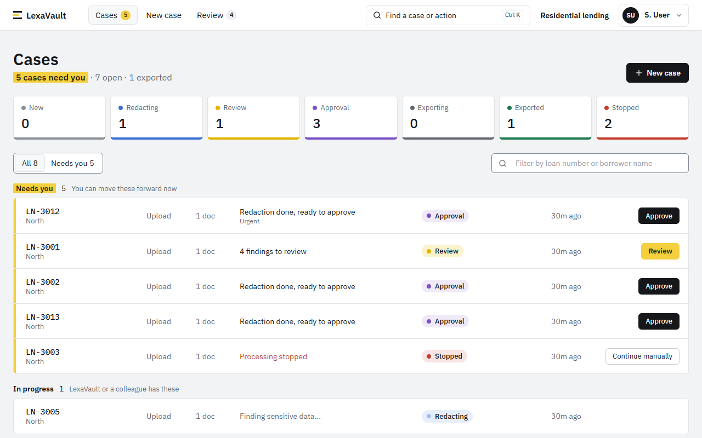

- The tiles count the cases in each stage: **New, Redacting, Review, Approval, Exporting, Exported, Stopped**. Choose one to see only its cases; choose it again to see all.
- **Needs you** holds what you can move forward now: Urgent first, then Normal, then Low, the oldest first.
- A row offers at most one action: **Review**, **Approve** or **Continue manually**. The rest is in the case panel: choose the row.
- The filter finds a case by its fields. A **sensitive** field is found by the whole value only.
- **Exporting** fills only where exports run as jobs (an installation setting). Elsewhere a case goes straight to Exported.

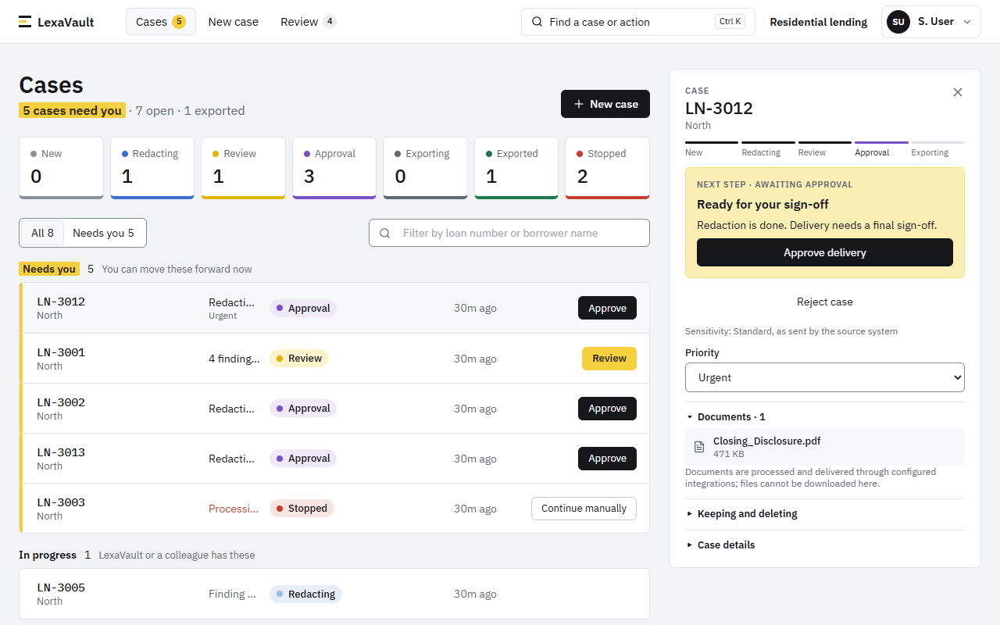

The case panel shows the stages, the next step, the priority, the documents' names and when each copy is deleted (**Keeping and deleting**). Files can't be opened or downloaded there.

## 5. New case

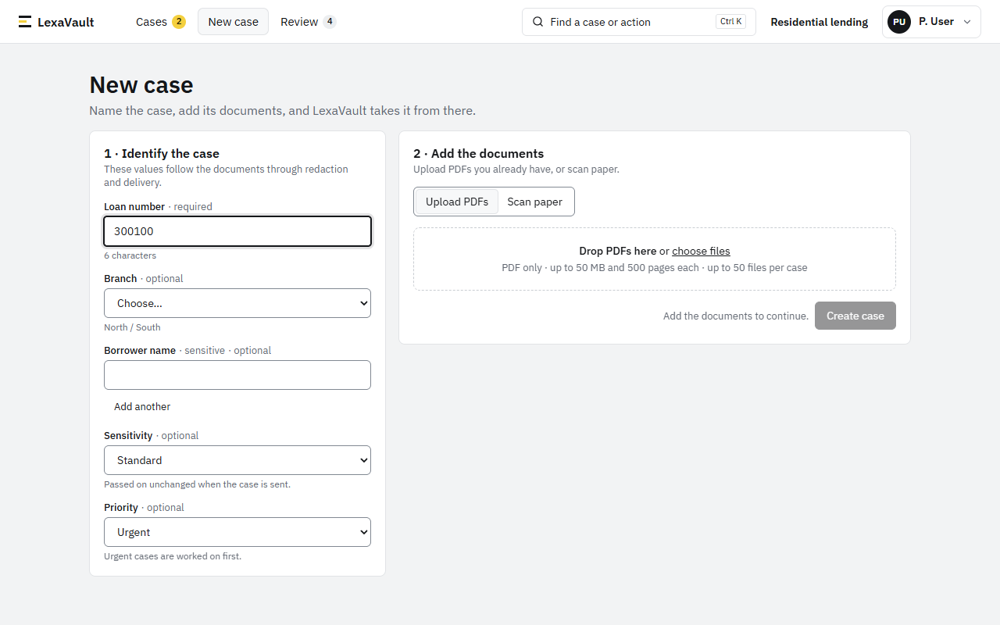

1. Fill in the fields (**1 · Identify the case**). Required fields are marked. A field that takes several values has **Add another**.
2. Choose **Sensitivity** if needed. LexaVault passes it on unchanged; it limits nothing here.
3. Choose **Priority**: Urgent, Normal or Low. Normal unless you change it.
4. Add PDFs (**Upload PDFs**) or use a scanner (**Scan paper**), then **Create case**. The result names the entity the files went to.

Limits: PDF only, up to 50 MB and 500 pages each, up to 50 files per case. A password-protected PDF is refused ("Password-protected file. Send it through the API."): ask for a copy without a password.

## 6. Review

A case comes to Review when LexaVault is not sure, or when the policy asks a person. You see only what needs a decision, not the whole document.

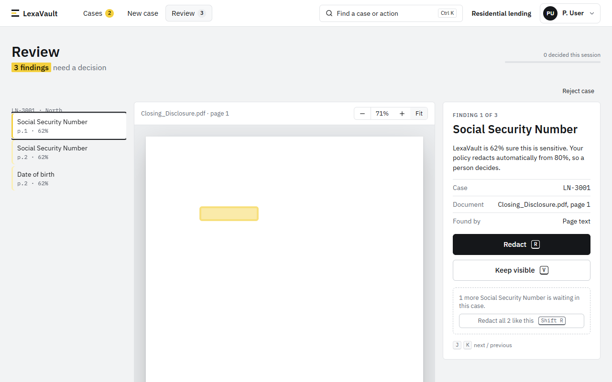

| Button | Key | Does |
|---|---|---|
| **Redact** | R | Blacks it out. Drag on the page first if the place is unknown or wrong |
| **Keep visible** | V | It is not sensitive: it stays readable |
| **Redact all N like this** | Shift R | All open findings of the same type in this case, after a question. Each is recorded on its own |
| | J, K | Next, previous |

The decision panel shows the found text to you; the list beside it shows it masked. A **Person name** always comes to Review, whatever its confidence. Below 80% (or the level your Business Admin set) every finding goes to a person.

After the last decision the case goes on by itself.

### Page to check

A page the vision model could not read: **Unreadable: check by hand**. Nothing on it was passed unread.

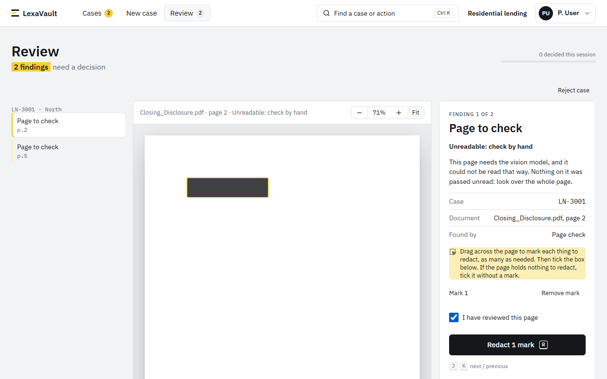

1. Look over the whole page.
2. Drag a box over each thing to redact, as many as needed. **Remove mark** takes one away.
3. Tick **I have reviewed this page**, then **Redact N marks**, or **Done, nothing to redact** when there is no mark.

It can't be finished without the tick, and **Keep visible** is not offered. Marks that were not sent are lost when you leave the page.

### Second check

Where your Business Admin switched it on, the finished file is read once more. If something may have been missed, the page comes back as a page to check: **Second check found something on page 3: SSN**. It names the kind and the page, never the value. Do the same as above. It never redacts by itself, it can be wrong, and it does not find everything.

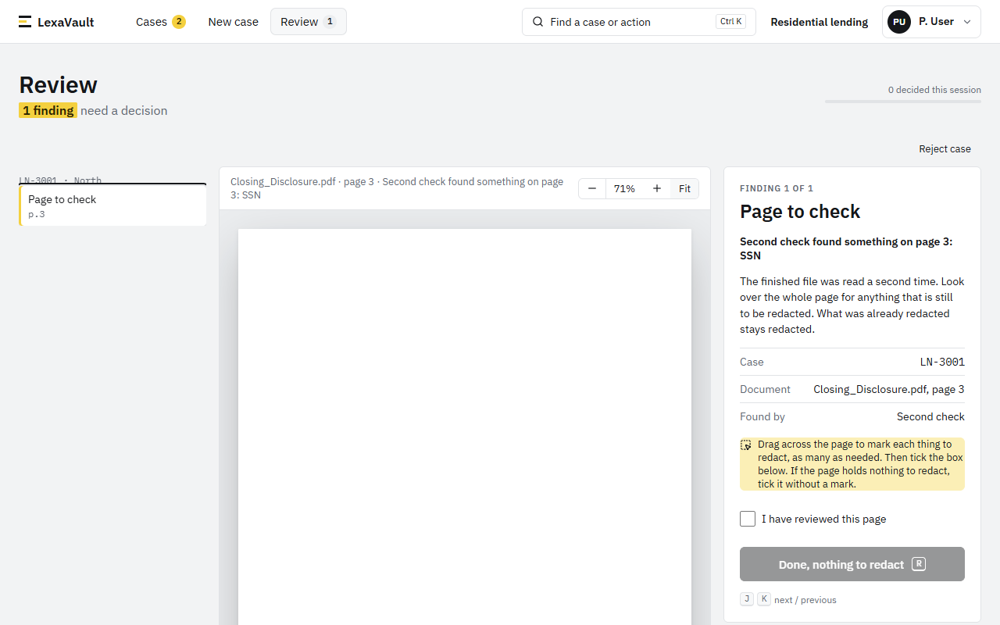

## 7. Reject a case

Use **Reject case** for a case that must not go out: in Review (Processor, Supervisor) or in Approval (Supervisor).

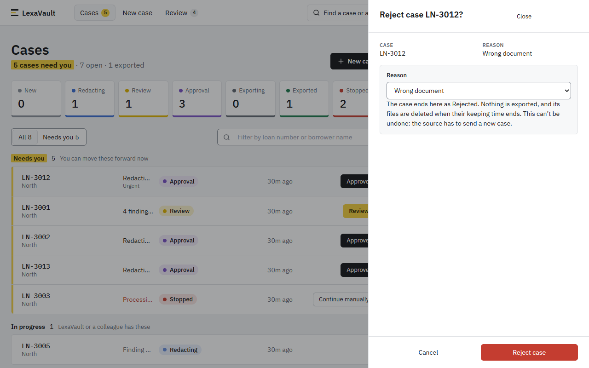

Reasons: **Wrong document, Unreadable, Out of scope, Duplicate, Other (see ticket)** (for Other, write the details in your ticket system; there is no text field on purpose). Nothing is exported and the files are deleted when their keeping time ends. **It can't be undone**: the source has to send a new case.

## 8. Priority

Urgent cases are worked on first, then Normal, then Low. A Processor or Supervisor changes it in the case panel; the waiting work moves at once. **Bulk** is the priority of cases from a migration source: they run after all other work, in the times IT set. You can't choose Bulk; you can move one Bulk case to Urgent, Normal or Low.

The order of automatic work follows the priority only where the installation processes documents in steps. The order of the **Needs you** list and of Review always follows it.

## 9. Approval (Supervisor)

Only where **Require a supervisor's approval before delivery** is on (it is off by default).

- **One case:** **Approve** on the row, or **Approve delivery** in the case panel. Delivery starts at once and can't be recalled.
- **Several:** choose the **Approval** tile, tick the cases (up to 50), **Approve selected (n)**, confirm. Each case is delivered and recorded separately; the result names each one that stayed, and why.

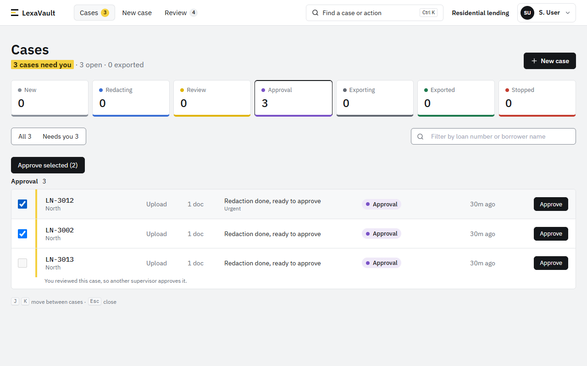

**Four eyes:** a case you reviewed yourself can't be ticked ("You reviewed this case, so another supervisor approves it.", LV-REV-015). This rule holds for approving **several** cases. The single **Approve** button does not check it.

**By link:** where notifications and approval links are set up, a Supervisor gets an e-mail with a link. It works for that person, for that version of the case, once, for 24 hours. Opening it decides nothing; choose **Approve delivery**, or a reason and **Decline delivery**. After a decline the person who submitted the case is told, and the case still waits: it can be approved on the case. The link never goes to the person who submitted the case.

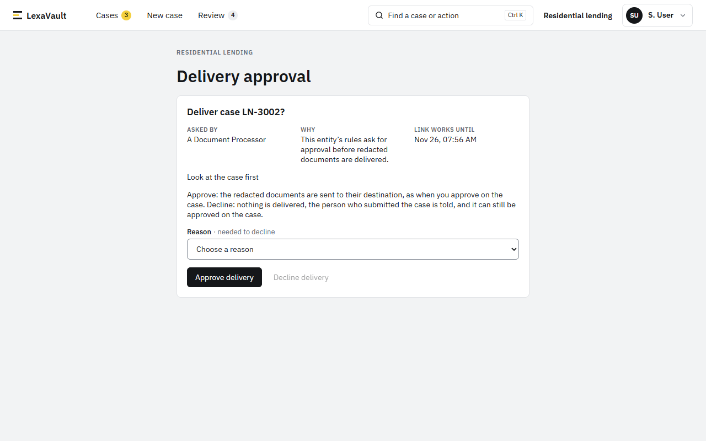

## 10. After the export

- **Process again** (Supervisor, in the case panel of an exported case): runs redaction again on the kept original, while it is kept and runs are left ("2 of 3 runs left"; the first export is one of the three).
- **Waiting for you** (Processor, Supervisor) shows only while a destination refused a case. Fix the cause with the destination's team, then **Resend all N**, or open the case and **Resend this case**. A case refused again goes to IT (LV-DLV-015).

## 11. Continue manually

When automatic processing stopped at the AI analysis and the PDF is still kept, a Processor or Supervisor can finish the case by hand. For any other stop LexaVault says why it is not possible; IT retries it.

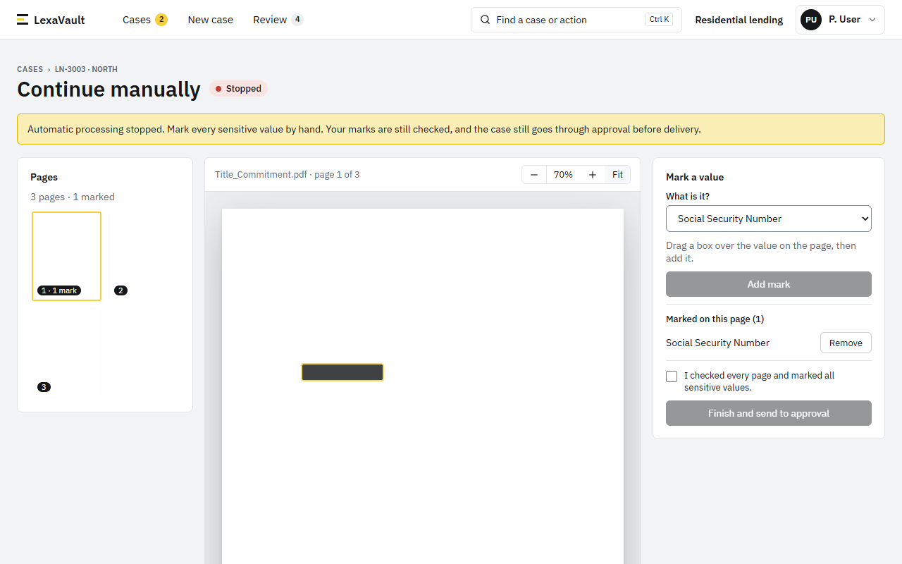

1. **Continue manually** on the case, and confirm.
2. Choose a page by its picture under **Pages**.
3. Choose **What is it?**, drag a box over the value, **Add mark**. Use the smallest box that covers it.
4. A wrong mark: **Remove** under **Marked on this page**.
5. When every page is done, tick **I checked every page and marked all sensitive values.** and choose **Finish and send to approval**.

Redaction and checking run next. If approval is off for the entity, the case goes on to delivery without it, although the button says "approval". There is no way to send the original. IT keeps the technical problem open; that is normal.

Marking needs a mouse or pen and works best on a computer.

## 12. Reports (Business Admin, Report Viewer)

Three tabs with one period (**Today, Yesterday, 7 days, 30 days, Custom**), one source system filter and one level filter. Days are in the entity's time zone.

| Tab | Holds |
|---|---|
| **Overview** | What LexaVault did for you, the headline, received and delivered per day, service levels |
| **Daily intake and delivery** | Received, Exported, Not exported yet, Needs attention; by reason, destination, source system, result and level; a note when a source is quiet |
| **Operations** (Business Admin) | The queue and time left, pipeline, backlog age, retention, timing, breakdowns by case field |

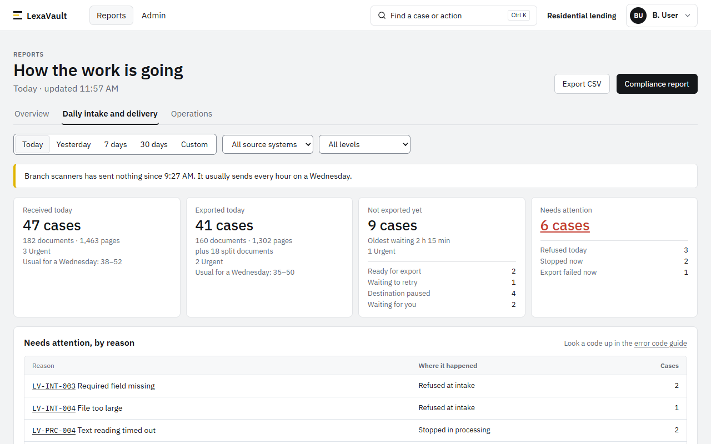

- **Export CSV** saves the tab shown. **Compliance report** makes the summary PDF; the IT Administrator adds the full audit trail.
- "Delivered" on Overview counts a case at its first delivery; "Exported" on Daily counts every case exported in the period, so the two can differ.
- The time left is an estimate. It shows only where documents are processed in steps.
- Targets are set in **Admin › Redaction & retention**, card **Report targets**.

## 13. Admin for the Business Admin

### Redaction & retention

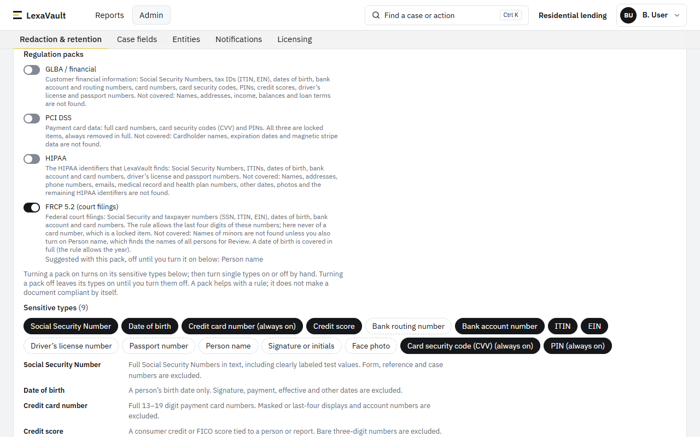

- **How much should a person check?** Strict, Balanced (80%, the default) or Light (70%). A change shows what it would have meant in the last 30 days. Under Strict a case with nothing found is still delivered without a check.
- **Regulation packs** (GLBA / financial, PCI DSS, HIPAA, FRCP 5.2): one switch turns on all their types. Turning a pack off leaves its types on. A pack says what it does not cover; it does not make a document compliant by itself.
- **Sensitive types:** on for a new entity: Social Security Number, date of birth, credit score. **Always on:** full card number, card security code, PIN. Off until you turn them on: bank numbers, ITIN, EIN, driver's license, passport, person name, signature, face photo.
- **What stays visible:** remove fully, or keep the last 4 for the types that allow it. Never for the always-on types.
- **Check the finished file a second time** (off by default; the FRCP 5.2 pack turns it on).
- **Read hard pages with the vision model**, **Searchable redacted pages**, **Treat labeled last-four SSNs as sensitive**.
- **Keeping and deleting:** originals and redacted copies are kept for hours counted **from the export**; stopped and rejected cases 3 to 30 days. **Require a supervisor's approval before delivery** is here too. **Keeping exported copies** sets it per destination.

Changes reach new cases only, and each is in the audit trail.

### Case fields

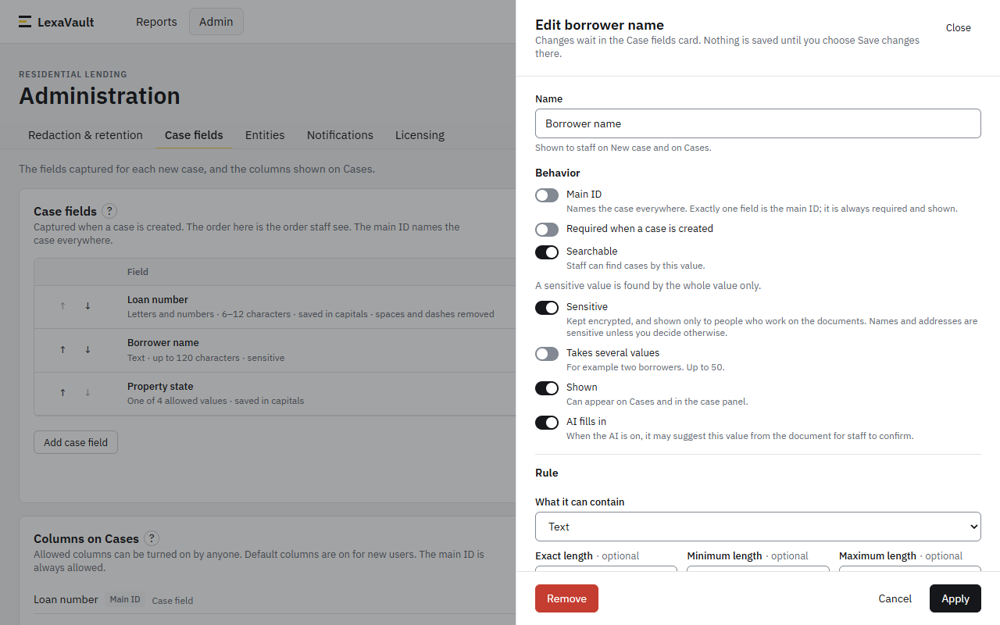

Exactly one field is the **Main ID**. A field has a type (text, numbers, money, date, list, address and so on), and can be **Required**, **Searchable** (found by the whole value, its beginning or any part), **Sensitive**, **Takes several values**, **Shown**, **AI fills in**.

- **Sensitive** values are kept encrypted and shown only on the case, to Processors and Supervisors. It needs the key service.
- Once a field has values its type, Sensitive, Main ID and several-values can't change: add a new field.
- **Remove** switches a field off; its values stay. **Switch on** brings it back.
- A thing is either a case field or a redaction type, not both. SSN, card number, card security code and PIN are never a field.

### Entities

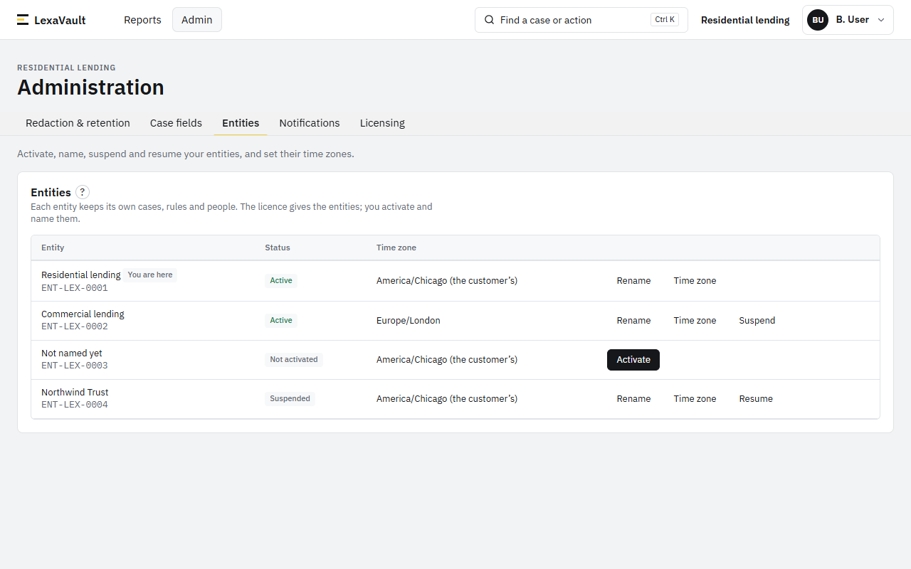

**Activate**, **Rename**, **Suspend**, **Resume**, **Time zone**: for the entity you are in and others you are a Business Admin of. You can't suspend the entity you are in. Activating is once and for all and counts in the licence; an entity can't be removed. Suspending stops people and new documents; cases already here are finished. The very first entity is activated by IT with a command (`../../install/SETUP.md`).

### Notifications and Licensing

**Notifications:** the business messages (work that waits, approvals, licence and use, changes of the redaction policy), on or off, how often, and who gets them. IT sets up the mail account. People get messages after they signed in at least once. **Licensing:** the licence and this month's pages, read-only.

## 14. Help: error codes

Account menu › **Help: error codes**. A code such as LV-DLV-002 is a link to its entry: what it means, who acts, what to do, and what Support tells the customer.

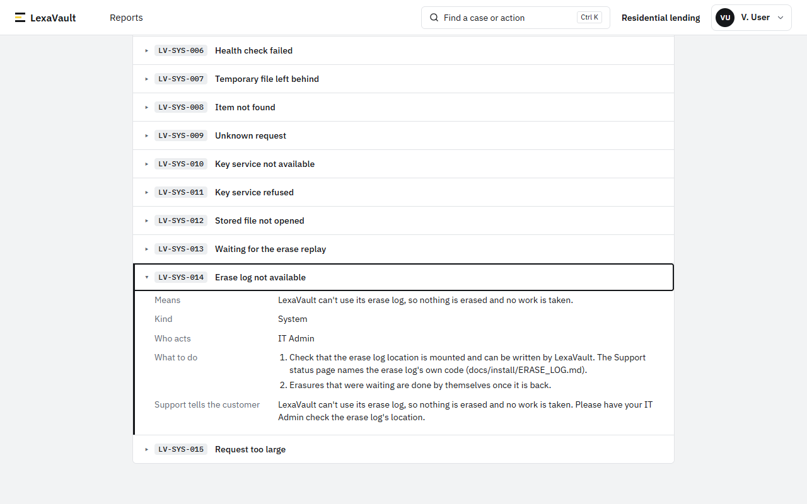

## 15. When you ask for help

Give: the error code and the reference (`R-...`) on the screen, the Main ID of the case, the time, and what you were doing. Never put document text, found values or a picture of a document into a ticket or chat.
