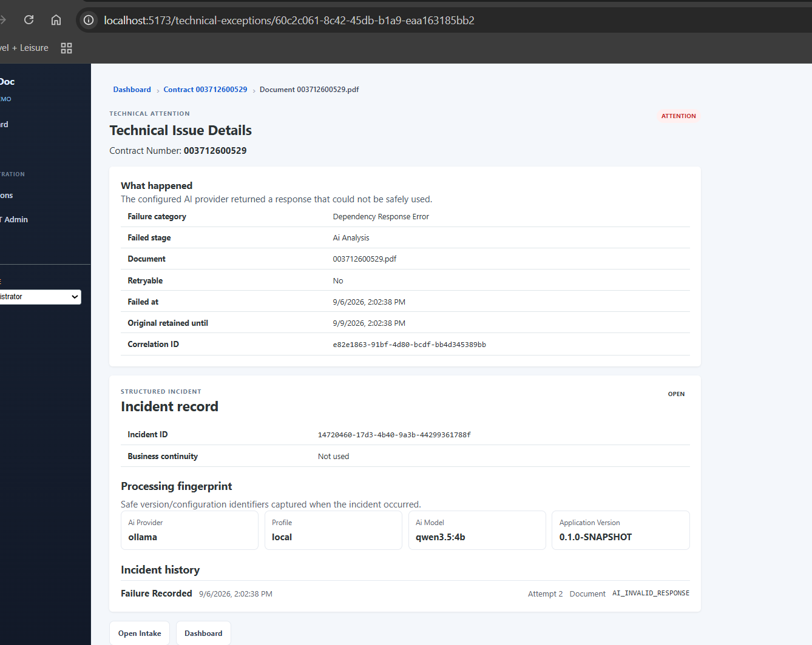

# LexaVault Tenant IT Support Guide

**Audience:** Tenant IT Admin  
**Purpose:** Tenant-side operational support without exposing protected document content.

---

## 1. Tenant IT responsibilities

Tenant IT supports:
- tenant connectivity/integrations
- technical configuration and enablement
- technical incident triage
- safe retry/reprocessing where authorized
- environment/connectivity diagnosis
- escalation to Platform Support

Tenant IT does **not** own the business decision to manually redact a document. A Standard Business User may continue through Business Continuity when the PDF remains safely processable.

---

## 2. Technical Attention vs business status

Do not assume:

`Technical incident open = Business blocked`

Business Continuity intentionally separates the two.

Example:

- Technical incident: `BUSINESS_CONTINUED`
- Business outcome: `COMPLETED`
- `resolved_at`: empty

Meaning:
- business safely completed the document manually
- the underlying technical issue still requires IT/platform investigation

---

## 3. Technical Issue Details

Current structured incident view may show:

- Incident ID
- Incident status
- Failure category
- Failed processing stage
- Reason code
- retryable yes/no
- failure time
- original retained-until time
- correlation ID
- Business Continuity status
- processing fingerprint
- incident history

---

## 4. What to capture before escalating

Preferred identifiers:
1. Incident ID
2. Contract Number / tenant primary business identifier
3. Correlation ID
4. Approximate failure time
5. Processing stage
6. Reason code
7. Whether Business Continuity was used
8. Whether the business outcome is blocked or completed

Do not send raw document content unless an approved secure diagnostic procedure explicitly authorizes it.

---

## 5. Reading the current AI failure example

Example structured classification:

- stage: `AI_ANALYSIS`
- component: `AI`
- failure category: `DEPENDENCY_RESPONSE_ERROR`
- reason code: `AI_INVALID_RESPONSE`
- attempt count: `2`
- retryable: `false` after bounded automatic recovery is exhausted

This does **not** mean LexaVault immediately gave up.

The AI Processing Resilience flow is:

`same-batch retry -> split multi-page batch -> page-level retry -> Technical Attention only after exhaustion`

---

## 6. Incident lifecycle

Expected current lifecycle for a business workaround:

`FAILURE_RECORDED`
`-> BUSINESS_CONTINUITY_STARTED`
`-> BUSINESS_CONTINUITY_SUBMITTED`
`-> BUSINESS_COMPLETED`

Parent incident:

- status: `BUSINESS_CONTINUED`
- business continuity used: `true`
- business outcome: `COMPLETED`
- resolved at: `NULL`

This is correct. Do not manually mark it resolved merely because Business completed.

---

## 7. Processing fingerprint

The fingerprint records safe version/configuration identifiers used when the failure occurred.

Current fields may include:
- application version
- profile
- AI provider
- AI model

Future fields may include:
- model version
- prompt version
- detector version
- OCR version
- document-profile version
- policy version
- configuration/intelligence bundle version

Use fingerprints to identify whether multiple incidents share the same processing configuration.

---

## 8. Retained original

LexaVault uses the unified original-document retention policy.

The Technical Issue Details screen may show **Original retained until**.

Use the retained original only through authorized LexaVault/platform procedures. Do not make uncontrolled copies for troubleshooting.

If the reproduction window expires, use the Contract Number / primary business identifier to reacquire the document from the source when permitted. A future support capability should compare document hashes to determine whether a reacquired document is the exact same input.

---

## 9. Safe support ticket content

Safe:
- Incident ID
- Contract Number / business reference
- package/document IDs
- correlation ID
- reason code
- stage/component
- timestamps
- provider/model/version identifiers
- retry counts
- business outcome

Do not paste:
- raw prompt
- raw AI response
- OCR body text
- SSN
- PAN/card value
- DOB
- credit-score value
- customer document body
- screenshots exposing protected content

---

## 10. Escalation guidance

### Customer still blocked
Escalate with higher urgency when:
- manual fallback is not available
- PDF cannot safely render/redact/verify
- storage/integrity failure prevents safe processing
- delivery remains blocked
- widespread tenant impact is suspected

### Business completed
The ticket may be lower business urgency, but the technical incident should remain open if the automation defect is unresolved.

Provide Platform Support the Incident ID and processing fingerprint so they can correlate across logs/metrics and other tenants.

---

## 11. Structured JSON logging

**Status:** IN VALIDATION — final hardening follow-up.

Production/SaaS logging is designed for centralized ingestion. Each console event is emitted as one JSON object. JSON is also the Local/demo default; developers can explicitly request readable output with `-LoggingFormat Readable`.

### Correlation ID

A valid incoming `X-Correlation-Id` UUID is preserved for the request and returned in the response. If the header is missing or invalid, LexaVault creates a new UUID. The same safe correlation context is propagated to Spring-managed background processing and AI worker tasks.

### Safe fields

Tenant IT may use operational fields such as Incident ID, Correlation ID, package/document IDs, stage, reason code, provider/model, retry counts, status, and timestamps.

Do not ask users to paste raw prompts, raw AI responses, OCR/document text, or protected document values into tickets merely because logs are now JSON. JSON formatting changes the transport/structure of logs; it does not change the privacy boundary.

### Log level and local/on-prem rotation

Local support can change the application level with `-LogLevel TRACE|DEBUG|INFO|WARN|ERROR`; production should normally remain at INFO.

For local/on-prem deployments that need application-managed files, `-EnableRollingFileLog` enables JSON console plus bounded rotating JSON files. The default is daily/100MB rollover, 14 history periods, and a 2GB total history cap. SaaS/container deployments should normally leave file rotation to the centralized logging platform.

Operational log retention is separate from document/original retention.

## 11. Support Console — Incident Search & Triage

**Status:** IN VALIDATION

Use **Support Incidents** to search durable incidents by the tenant's Primary Business Identifier, Incident ID, Correlation ID, stage, reason code, status, and business outcome.

The result grid highlights **Business Impact**:
- BLOCKED — business is still blocked
- CONTINUED — Business Continuity is being used
- COMPLETED — business completed, even if the technical incident remains unresolved

Open a case to review the safe failure classification, processing fingerprint, durable incident timeline, and correlation IDs.

Do not paste document text, OCR output, protected values, raw prompts or provider responses into tickets.
