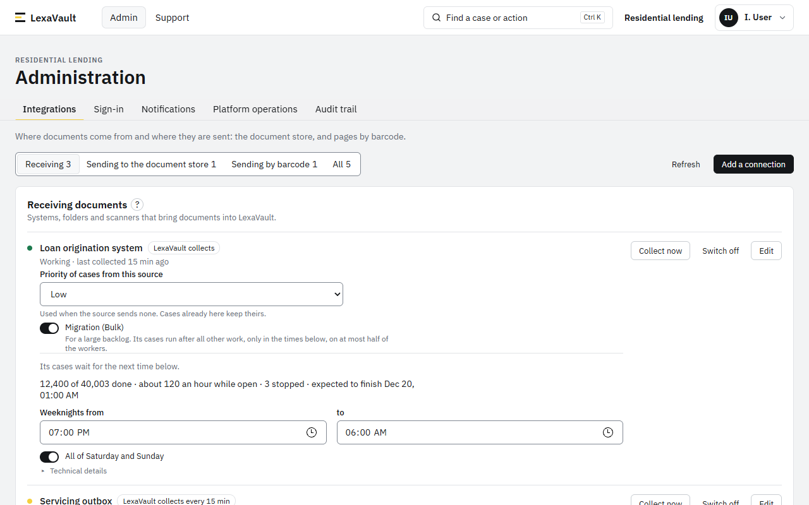
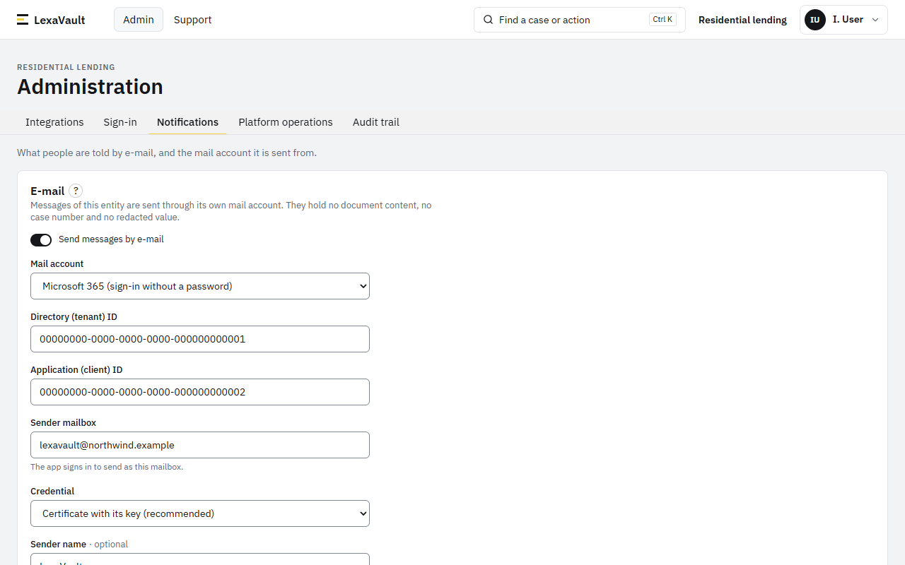
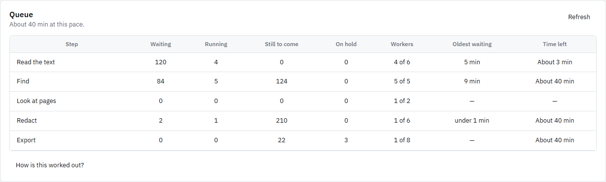
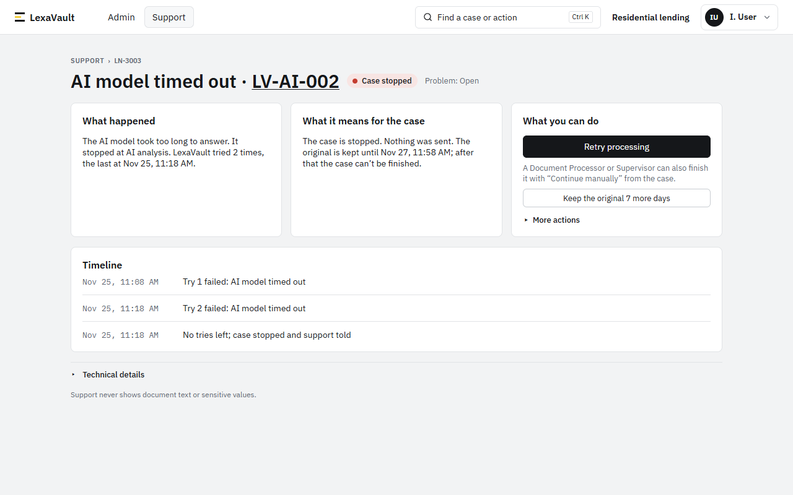
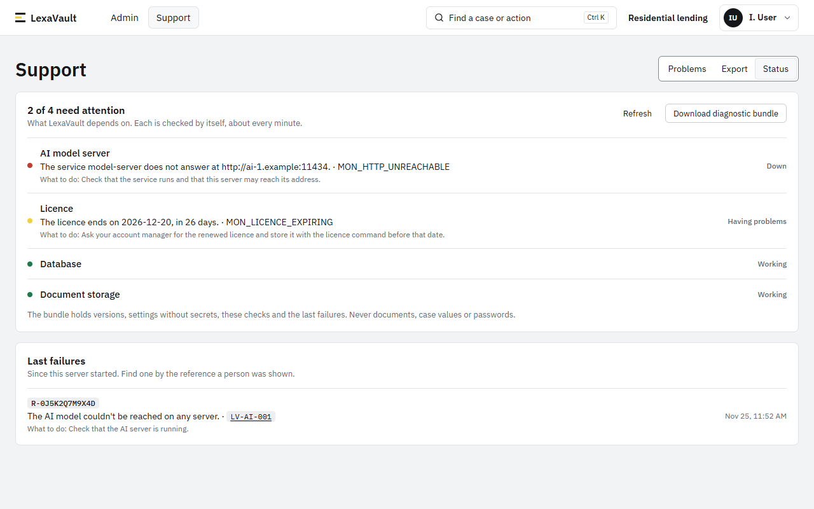
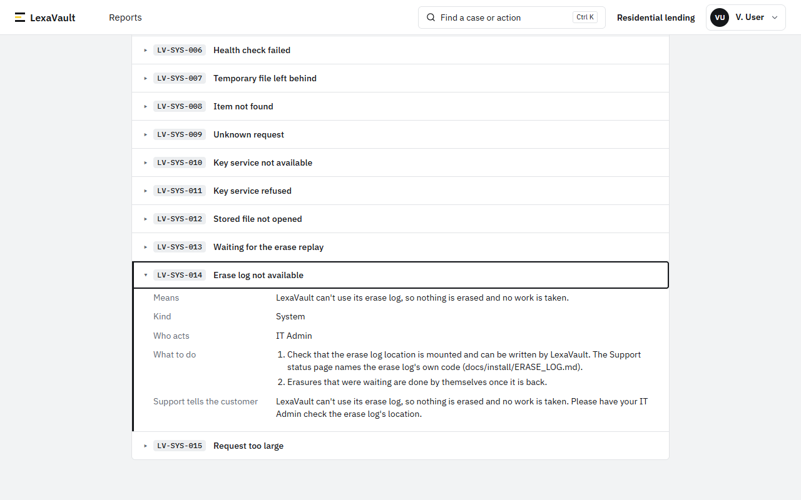

# LexaVault guide for the IT Administrator

**For:** IT Administrator ("IT Admin").
**Checked:** 2026-11-25 against the screens of commit `466906b1` (task 0095). Names in **bold** are the words on the screen. Installing and settings are in `../../install/`.

The pictures hold made-up data only.

## 1. What you can and can't do

| You can | You can't |
|---|---|
| **Admin › Integrations**: sources and destinations | Open **Cases**, **New case** or **Review**, or see a document |
| **Admin › Sign-in** | Approve, reject or review a case, or use **Continue manually** |
| **Admin › Notifications**: the mail account and technical messages | See **Reports** |
| **Admin › Platform operations**: overview and queue (read-only) | Change the redaction policy, case fields, entities or business messages (Business Admin) |
| **Admin › Audit trail**, its export, and the **Compliance report** with the full audit trail | Change storage, workers, branding or health checks (Platform Operations) |
| **Support**: Problems, Export, Status; retry; keep the original longer | See Admin › Licensing (Business Admin); a licence problem shows under Support, Status |

You see one entity at a time. The entity is at the top, left of your name; with more than one you switch there.

## 2. Integrations

Views: **Receiving**, **Sending to the document store**, **Sending by barcode**, **All**.

**Add a connection** has three steps: what it does, its details, **Test connection** and **Save**. How documents arrive: "A system sends them to LexaVault", "LexaVault collects them on a schedule", "From a watched folder", "From a scanner". A test never sends a customer document. A key is named, never typed and never shown. **Switch off** stops new documents; cases already here go on.

- **Check now** (watched folder) and **Collect now** (a source LexaVault collects from).
- **Priority of cases from this source:** Urgent, Normal or Low, used when the source sends none. Cases already here keep theirs.
- **Sending by barcode** › **Rules**: pages with a barcode or text marker go to another place as well. Files that couldn't be sent have **Retry**.

### Migration (Bulk)

For a large backlog. Switch on **Migration (Bulk)** at the source.

- Its new cases are Bulk: after all other work, on at most half of the workers, only in the times set (weeknights 7 PM to 6 AM and all weekend unless changed), in the **entity's** time zone. Without a time zone it can't be switched on; the Business Admin sets one in Admin › Entities.
- Outside the times files stay at the source, and nothing of it starts. **Check now** and **Collect now** still work.
- You see how many are done, waiting and stopped, the pace and the expected finish.
- Switching it off asks first (**End migration**): its waiting cases become Low.
- The times and the half hold for the steps documents are processed in (the staged pipeline, the only one since task 0121). A step with one worker does no Bulk work.

## 3. Sign-in

**Test sign-in** checks that the login system answers; it changes nothing. **Prepare a change** makes a draft: **Save draft**, **Test the draft** (a pasted token is checked once and never kept), **Switch to it**. **Go back to the previous sign-in** undoes a switch. A draft with another login system, provider ID or audience can be tested but not switched to here; see `../../install/SETUP.md`. Which group gives which role is loaded by setup, not here; the changes are listed under **Audit trail** › **Sign-in access changes**.

## 4. Notifications

- **E-mail:** Microsoft 365, or your own Exchange server or relay. You give the name of a stored secret, never the secret. **Send me a test message** goes to your own address.
- **Who gets messages:** people of the role in this entity who signed in lately.
- **Technical messages:** on or off, how often, after how long. Some are **Always on**.
- **Last messages:** the last 10 and why one was not sent.

A message never holds document content, a case number or a redacted value. Setting up and approval links: `../../install/NOTIFICATIONS.md`.

## 5. Platform operations

The services, the watched folder, recorded technical incidents, and the **Queue** of your entity.

**Time left** is worked out from the pace of the last minutes (**How is this worked out?**). It leaves out what is on hold and cases that wait for a person. On long loads it was within 7%; on loads of about 2 minutes up to 54% too long. It shows only where documents are processed in steps.

## 6. Support

### Problems

One row per problem: **Open**, **Resolved**, **All**; one search box (Main ID or incident number); **More filters** for stage, reason, retry, times and ids. A problem shows its code, what happened, what it means for the case, what you can do, and a timeline.

| Action | Does |
|---|---|
| **Retry processing** | Runs the stopped step again on the kept original |
| **Keep the original 7 more days** | So there is time to look into it |
| **More actions** | Keep 14 or 30 more days, stop keeping it longer, close without processing again, close as replaced or duplicate |

The case's chip says **Case stopped**, **Continued manually** or **Case finished**. A problem stays open when people finish the case by hand: the case is done, the cause is not fixed. The line about "Continue manually" is shown on every blocked problem, but LexaVault allows it only when the AI analysis stopped.

All ids and internal codes are under **Technical details**. Support never shows document text or sensitive values.

### Export

**Needs IT:** exports that wait for you, by destination and code, with **Retry all N**, or **Set back to working** after a sign-in failure. **Destinations:** Working, Paused (checked by itself; **Check now**), Needs IT. This fills only where exports run as jobs (`SECUREDOC_PROCESSING_EXPORT_MODE=job`).

### Status

What LexaVault depends on: Working, Having problems or Down, with the code, the cause and what to do. **Last failures** is found by the reference (`R-...`) a person was shown. **Download diagnostic bundle** holds versions, settings without secrets, the checks and the last failures; never documents, case values or passwords. What each check looks at: `../../install/MONITORING.md`.

## 7. Error codes

Account menu › **Help: error codes**, or choose any LV code on a screen. Each entry has "Support tells the customer". A link opens in a new tab and can be read there without signing in.

## 8. Audit trail and compliance report

Filter by type, person, period or case. **Export** gives CSV or JSON. **Compliance report** makes the PDF, with **Include full audit trail** (you only; the Business Admin makes the summary on Reports). It holds no borrower names, file names, loan numbers or redacted values.

## 9. A safe ticket

Send: incident number or reference, LV code, Main ID if your rules allow, times, whether the case is stopped or finished, the diagnostic bundle.
Never: document text, found values, prompts or AI answers, pictures of documents.

Raise it higher when the case is stopped and can't be retried or continued by hand, delivery is blocked, storage or the key service is down, or many cases stop with the same code.

## 10. Logs

One JSON event per line. A valid `X-Correlation-Id` is kept for the request; every answer has `X-Request-Id`, and an error the same value as `reference`. Local starts: `-LogLevel TRACE|DEBUG|INFO|WARN|ERROR`, `-LoggingFormat Readable`, `-EnableRollingFileLog` (daily and 100 MB files, 14 periods, 2 GB). Log keeping has nothing to do with document keeping.
